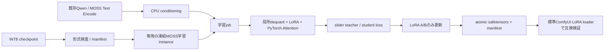

# Comfy-moss-slider-node 実装計画書

作成日: 2026-10-19。対象: 指定された MOSS SFT INT8 ConvRot checkpoint を凍結基底として使用する、ComfyUI 向け Slider LoRA 学習ノード。

**結論:** 現行 ComfyUI のネイティブ MOSS 実装を基盤に、Krea2 ノードの局所 dequant・入力勾配・slider objective と、sd-scripts の MOSS 固有契約を組み合わせる。指定重みの packed QKV はそのまま保持できる。最初に解決すべき点は、ConvRot の計算規約、学習時 Attention、packed QKV に対する LoRA の注入・保存である。

**計画作成時の成果物（実装結果は第11節）:** リポジトリ解析、実ファイルの軽量検査、ConvRotの小型CPU検証と再現スクリプト、実装方針、CPU 検証までの作業分解、後日の実機検証手順。製品コード・学習済み LoRA の完成を意味しない。実装作業の到達点は P7「実機検証に持ち込める状態」とし、P8 を実機待ちとして区別する。

根拠の区分: **確認済み**=ローカルコード・ファイルを直接確認、**設計**=今回の採用案、**未検証**=実行による証明が残る事項。ソース参照のパスはすべてワークスペース `C:/Users/inott/Downloads/新しいフォルダー` からの相対パス。将来作るファイルは対象プロジェクトからの相対パス。

## 1. 要件と範囲

### 要件

- 指定 `moss_image_sft_int8_convrot.safetensors` を基底にし、INT8 重み・scale・ConvRot 設定を更新せず LoRA A/B のみを学習する。
- Krea2 と同様の text-driven slider を作り、保存した LoRA を MOSS 推論で正・0・負の強度で利用できるようにする。
- 量子化された基底の保存形式を維持し、モデル全体を常駐 BF16 重みへ展開しない。最初の学習 backend は各 Linear の計算中だけ dequant する。
- GPU が使えない開発段階でも、形状・数式・勾配・保存形式・ノード契約・中断後の復旧を小型 CPU fixture で検証できるようにする。
- 参考リポジトリは変更しない。新規プロジェクト内で実装し、ComfyUI の既存 API とモデル実装を利用する。

### 初期版の設計上の仮定

単一 slider、batch size 1、target/positive/negative のテキスト条件、single 方向の学習を初期範囲とする。負の適用強度も数式・保存上は対応するが、逆方向の画質効果を single 学習だけで保証しない。bidirectional 学習は初期版完成後の小拡張とする。[E07]

初期版には画像 dataset 学習、text encoder 学習、text refiner 学習、領域 mask、複数 slider 同時学習、永続 cache、optimizer resume、独自 frontend、非同期 block swapping、Triton 必須経路を含めない。これらは Krea2 全機能との同一性を求める場合の追加範囲である。既存 Krea2 にも永続 teacher cache や resume が備わっているとは仮定しない。[E08]

## 2. 解析対象と再現条件

| 対象 | 調査時の commit / 状態 | 主な役割 |
|---|---|---|
| MOSS-Image | `c1355e6b1986dfe8fba3c0455783a05899212342` / clean | 公式アーキテクチャ、Qwen、VAE、conditioning |
| Confyui-krea2-slider-node | `614d2a8e7f424b047b92cd94201b61a817819eb1` / clean | INT8 凍結学習、slider objective、保存・job lifecycle |
| sd-scripts | `04ca541746b7667b27eab230db067579f682895e` / clean | MOSS 専用 trainer、ConvRot backward、LoRA key |
| ComfyUI | `8f04fd6ecf4a548937971e840af2a985529fab76` / clean | ネイティブ MOSS、quant loader、LoRA mapping、V3 API |
| Comfy-moss-slider-node | 調査開始時は空ディレクトリ、Git 未初期化 | 今回の成果物と今後の実装先 |

実ファイルの検査記録: [2026-10-19-moss-int8-inspection.json](2026-10-19-moss-int8-inspection.json)。Git commit と clean 状態はこの記録に保存した。

更新後のローカル Python 環境は Python 3.10.11 / torch 2.10.0 / safetensors 0.7.0 / numpy 2.1.3 / pytest 9.0.2 / **comfy-kitchen 0.2.39**。ユーザーによる更新後に版を再確認し、ComfyUI の pin と一致した。transformers 5.2.0、diffusers と accelerate は未導入。[E13]

本案は ComfyUI ネイティブを利用するため、MOSS 公式 Diffusers アプリ全体や sd-scripts/accelerate を必須依存として追加しない。公式 Diffusers 経路を比較に使う場合だけ、別環境で `MOSS-Image/pyproject.toml:11` の条件（torch>=2.9、diffusers>=0.38、transformers>=5.3）を満たす。全環境をまとめて更新する作業は含めない。

## 3. 確認できた事実と判断

| 優先度 | 結論 | 確度 / 根拠 |
|---|---|---|
| 1 | 指定重みは現行 ComfyUI native MOSS の packed 形式に一致する。公式旧 custom loader への QKV 分割変換は初期版に不要 | 高 / 実ファイル、[E01][E02] |
| 2 | Krea2 型の局所 dequant + 凍結基底の input backward を使える設計根拠がある | 高。ただし MOSS 実機性能は未検証 / [E03][E04] |
| 3 | sd-scripts に MOSS 専用学習が既にあり、汎用 Flux trainer から推測して作り直す必要はない | 高 / [E04][E05] |
| 4 | INT8 Attention と汎用 quant Linear の通常推論経路を、そのまま学習対応とみなせない | 高 / [E06][E10] |
| 5 | q/k/v 論理キーの標準 LoRA mapping と、bypass loader の受理形式には別の制約がある | 高 / [E09]。実行確認は P4 |
| 6 | 学習時間・必要 VRAM・画質・効果の単調性は CPU/ヘッダー検査から決められない | 未検証 / P8 で測定 |

### 3.1 指定 checkpoint の実測

| 項目 | 結果 |
|---|---|
| ファイルサイズ | 5,413,698,958 bytes、約 5.042 GiB |
| ヘッダー | 75,848 bytes、`__metadata__` は空 |
| tensor 数 | 757: I8 168、BF16 210、F32 169、U8 210 |
| DiT | 42 block、hidden 3072、FFN 8192、head 数 24、head dimension 128 |
| latent / conditioning | モデル入力 128 channels、text feature dimension 4096 |
| 全168 quant 設定 | `format=int8_tensorwise`, `convrot=true`, `convrot_groupsize=256` |
| 全42 attention 設定 | `attention=comfy_kitchen_int8` |
| scale | 1,333,248 要素を検査。非有限値 0、0以下 0 |

各 block の INT8 行列は次の4個。scale はすべて F32 の `[out_features,1]`。

| module | weight shape |
|---|---|
| `layers.N.proj.qkv` | `[9216,3072]` |
| `layers.N.proj.o` | `[3072,3072]` |
| `layers.N.proj.ffn_up_gate` | `[16384,3072]` |
| `layers.N.proj.ffn_down` | `[3072,8192]` |

全 tensor のバイト数、offset の連続性、payload 終端、全42 block の形状・scale dtype を確認済み。読み取ったのはヘッダー、設定 JSON 13,566 bytes、scale 5,332,992 bytes で、巨大な基底行列はロードしていない。

これは数値的なモデル健全性・生成品質の証明ではない。ヘッダー SHA256 は記録したが、**ファイル全体の SHA256 ではない**。重み内容が違っても同じヘッダーになり得るため、正式な training manifest には実行準備時に全ファイル digest を一度計算して保存する。

### 3.2 参考実装の使い分け

| 参照 | 採用するもの | そのまま移植しないもの |
|---|---|---|
| Krea2 node | FrozenLinear の input gradient、FP32 LoRA、teacher 式、atomic export、job lock、cancel/finally | Krea モデル、16ch latent、conditioning、module 名、schedule、Krea metadata |
| sd-scripts MOSS | 252個の論理 target 名、FM 速度の符号、latent/time 規約、ConvRot の参照式 | trainer CLI、dataset pipeline、accelerate、CUDA/Triton の必須化 |
| ComfyUI native | `MOSSImage`、fused QKV、quant metadata、conditioning、標準 LoRA mapping、V3 node API | 汎用 inference kernel を無検証で学習に流用すること |
| MOSS 公式 plugin | 原モデルとの対応、Qwen prompt template、Flux2 VAE | 分離 Q/K/V loader を指定 packed checkpoint の主経路にすること |

Krea2 の文書には実機テスト履歴があるが、現行 single 方向は3 step、native 入力は1 stepの記録に限られる箇所があり、MOSS の学習成功を保証しない。raw log は調査した checkout に存在せず、今回確認したのは文書記録である。[E12]

### 3.3 更新後のConvRot CPU検証

comfy-kitchen 0.2.39、torch 2.10.0+cpuで、出力幅8・入力幅256/512・group256の小型合成INT8行列を検証した。実checkpointの行列やGPUは使用していない。

| 比較 | 結果 |
|---|---|
| KreaとCKのHadamard、activation回転、weight回転 | 両入力幅で完全一致 |
| CK dequantと独立Hadamard参照 | 最大誤差0 |
| Krea FrozenLinearの浮動activation forward・入力勾配と各独立参照 | 両入力幅で最大誤差0 |
| CK eager量子Linearと独立のactivation量子化込み参照 | 最大誤差約1.91e-6 |
| CK eagerの入力勾配とdequant行列による参照 | 最大誤差約4.29e-6、atol/rtol=1e-5で合格 |

再現用の解析スクリプト: [2026-10-19-convrot-cpu-probe.py](2026-10-19-convrot-cpu-probe.py)。機械可読結果: [2026-10-19-convrot-cpu-probe.json](2026-10-19-convrot-cpu-probe.json)。これはP2の数学上の前提を裏付ける事前probeであり、新規FrozenLinearの実装テスト、多層LoRA、Attention、実checkpoint、GPU backendは未検証。

CK量子Linearのforwardはactivation量子化を含み、Krea eagerのforwardは含まない。両者のforwardを同じ関数とはみなさない。また量子forwardの入力勾配比較はdequant行列を使う勾配規約の検証で、round/clampの真の微分を証明するものではない。nativeの汎用`QuantLinearFunc`分岐を通らないことだけから「INT8は一切backward不可」とは結論しない。[E06]

## 4. 採用アーキテクチャ



### 4.1 モデルの所有権とロード

**採用方式:** native `MOSSImage` をmeta deviceで構築し、`safetensors.safe_open(..., device="cpu")` からtensor単位で読み込む専用学習loader。Kreaの逐次loaderと同じ所有権にし、168個の量子Linearを本プロジェクトの`FrozenLinear`へ置換する。native MOSSのアーキテクチャ・検出仕様・quant metadataの**形式契約**を再利用するが、推論用`comfy.sd.load_diffusion_model`が作る`ModelPatcher/QuantizedTensor`の変換経路は初期版で使わない。[E01][E06][E17]

具体的には、headerでshape/configを検証→native `MOSSImage(..., fused_qkv=True, device="meta", dtype=compute_dtype, operations=comfy.ops.manual_cast)`（disable_weight_initを継承し、F32保存重みとBF16計算を整合させる）を生成→quant targetへI8/scale/configを割当→残りのfloat parameterを凍結状態で割当→全key消費・残存meta tensorなしを確認する。`rope.bands`はnativeと同じく明示的に処理対象外とし、42個のattention設定は検証・manifest保存した上で学習用backendへ置換する。ComfyUIのquant parserを呼び出すとの仮定や、巨大なBF16 state_dictの中間生成は置かない。

jobの所有権とデバイス移動は次に固定する。

1. job lockを取得し、他の学習で`in_training`が既に有効なら開始を拒否する。入力conditioningを通常のCPU tensorへcloneする。
2. 学習モデルの割当前に`comfy.model_management.unload_all_models()`で既存推論モデル・text encoderをComfyUI管理下でアンロードし、通常のcache解放を行う。元MODELの値・patches・hooksは変更しない。[E08][E17]
3. 学習instanceはjobだけが所有し、ComfyUIのloaded-model registryへ登録せず、`load_models_gpu`を呼ばない。float parameterとresident I8 bufferは個別にtraining deviceへ移す。staging指定blockのI8/scaleはCPUに保持し、各Linear forward/backward中だけ同期転送する。全体への`.to(device)`でCPU bufferを一括移動しない。
4. native dynamic prefetchは有効化せず`prefetch_dynamic_vbars=False`とする。nativeのmalloc graph判定は`in_training`だけでは無効にならないため、学習contextで`comfy.model_prefetch.args.disable_comfy_compiler`の元値を保存し、一時的にTrueへ設定してfinallyで復元する。activation checkpointingは本ノードのblock境界で管理し、ComfyUIの推論offloadと同じbufferの移動を二重管理しない。[E17]
5. 成功・例外・cancelの全経路で、保存ハンドル、optimizer、grad、adapter/hook、model、conditionのjob参照を解放し、training/compiler flagを元へ戻し、cache解放後にlockを離す。学習instanceをノード出力に残さない。既存推論モデルは次の通常ComfyUI利用時に管理機構が再ロードする。

既存MODELのstorage pointer検査は管理下のunload後を基準にし、その後の学習処理が既存storageを共有・変更していないことを検証する。unload自体によるdevice/storage変更と、禁止する共有weightの書換を混同しない。隣接リポジトリを`sys.path`へ追加する製品構成は採用しない。別案のModelPatcher起点は推論loader再利用に利点があるが、量子wrapper変換と独自stagingの所有権が増えるため初期版では採用しない。

### 4.2 INT8 基底の計算と勾配

`Q` を INT8 保存行列、`s` を行ごとの scale、`R` を group size 256 の正規化 Hadamard 行列とすると、参照式は次である。[E03][E04]

```text
Wrot = cast(Q) * s
y_base = (x R) Wrot^T + bias
dL/dx = (dL/dy Wrot) R^T
y = y_base + multiplier * (alpha/rank) * B(A(x))
```

LoRA には **回転前の x** を渡す。Hadamard の符号・順序・正規化を名前だけで同一視せず、comfy-kitchen 0.2.39 の dequant と独立参照の比較を P2 の gate にする。正規化された対称 Hadamard なら `R^T=R` だが、その前提もテストする。

初期 backend は Krea2 / sd-scripts eager fallback と同じく、activation を INT8 量子化せず浮動小数点で Linear を計算する。INT8 は基底の保存・常駐形式であり、W8A8 kernel を使う高速学習の保証ではない。custom backward は packed buffer と scale を保持し、BF16 展開行列を autograd の saved tensors に残さない。[E03][E04]

全基底を凍結し、optimizer の parameter 集合を A/B と完全一致させる。B=0 初期化では最初の backward で A の gradient が0になり得るため、初回から全 A/B の非ゼロ勾配を必須にする誤ったテストは書かない。B の更新と、2 step目以降の A の更新を確認する。[E07]

### 4.3 LoRA target と packed QKV

**初期実装は packed の4 target/block、計168 adapter を採用する。** qkv は rank r の共通 A と `[9216,r]` の B を持ち、基底 QKV を1回計算して差分を加える。o / ffn_up_gate / ffn_down も同じ構造とする。text refiner、time、norm、modulation、入出力投影は凍結する。[E01][E05]

保存形式は sd-scripts と整合する **q/k/v 論理キー** を採用する。qkv の A を q/k/v 各キーへ複製し、B を行方向に三分割する。alpha は各枝に同じ値を保存し、3倍・1/3の係数を追加しない。これで内部168 adapterに対し、保存時は252論理 target / 756 tensor（down、up、alpha）となる。共通 A のため、独立 A を持つ252 adapter 学習とは表現力が異なることを README に記す。[E05][E09]

標準 key 例: `lora_unet_layers_0_proj_q.lora_down.weight`、`.lora_up.weight`、`.alpha`。q/k/v の独立 A を学習する拡張は、packed rank rへ無条件に戻せないため初期範囲外。初期版の再読込は共通A・rank・alphaの一致を検証し、独立Aを持つ外部LoRAを黙って圧縮しない。標準ComfyUIへのexport互換と、任意の外部LoRAのimport対応は別の範囲とする。

**重要:** 標準 LoRA key mapping があることと、量子化 weight を変えずに bypass 適用できることは別である。現行汎用 bypass loader は fused offset tuple と文字列 key の扱いに不整合が疑われる。学習中は自前の packed-aware residual を用い、汎用 bypass loader の q/k/v 経路を前提にしない。[E09]

推論互換は二つの試験に分ける。①標準 LoRA loader の key/offset/alpha/±strength の数値互換、②同じ INT8 基底を保持した residual 適用の一致。標準 loader が merge/requantize する場合、その結果は②の証明にならない。②を標準機能で実現できない場合は、P4 内でプロジェクト専用の packed-aware apply node を追加する。ComfyUI 本体への修正は別提案とする。

### 4.4 学習 context と Attention

学習区間で `torch.inference_mode(False)` と gradient 有効化を行い、入力 conditioning をその区間で通常 tensor として clone する。`comfy.model_management.in_training` を設定して、native MOSS の differentiable RMS/AdaLN・RoPE・residual・FFN 分岐を通す。元の値は成功・例外・中断の全経路で復元する。[E10][E11]

全 DiT block と2個の text refiner block の Attention を、学習 instance でのみ PyTorch の autograd 対応経路へ明示固定する。checkpoint 内の42個の `comfy_kitchen_int8` 設定が override より優先されないことを検証する。teacher も同じ backend を使い、teacher/student 間の kernel 差を学習目標に混入させない。[E06][E10]

全体の module 関数を恒久 monkey patch しない。並行 job は lock で拒否し、ComfyUI 管理のモデルは unload/cleanup 契約を守る。INT8 Attention と PyTorch Attention の数値・速度差は P8 で測る。

### 4.5 latent、時間、conditioning

- モデル内 latent は `[B,128,H/16,W/16]`。MVP はこの正規化済みモデル空間で noise を直接作る。幅・高さは16の倍数に限定する。[E14]
- raw Flux2 VAE latent は `[B,32,H/8,W/8]`。画像学習へ拡張する際は2×2 patchify と BatchNorm normalization が必要であり、単なる reshape・任意 scale で代用しない。[E05]
- native ComfyUI は sampling multiplier=1、内部 `timestep_embedding` が1000倍する。**native MOSS への入力時刻は sigma** とする。sd-scripts の MOSS 呼出は `1000*sigma` であり、同じ値を両方へ渡してはならない。sigma/timestep は FP32 のまま扱う。[E15]
- native 推論 schedule の既定 shift=5 と、sd-scripts の事前学習分布近似（shift=1、logit-normal等）は目的が異なる。MVP slider の rollout は native sampling の shift=5 を明記し、shift済み sigma に二重 shift しない。画像 dataset 用の時間分布を根拠なく移植しない。[E05][E15]
- MOSS の tokenizer/chat template と4096次元最終特徴を使う。conditionごとの真の token 長を保存し、異なる長さの target/positive/negative を repeat-padding してまとめない。native wrapper は true text length に基づく RoPE を前提にする。[E14]
- 提示されたファイルは DiT のみ。実 prompt encode には別の Qwen3.5-9B weights/tokenizer が必要。**text-driven noise rollout の学習そのものには VAE は必須ではなく、生成画像の確認・画像入力学習で必要**。CPU テストには短い合成 conditioning を使う。[E14]

`CONDITIONING`の初期版受理契約は、各roleにつきentry数1、batch1、float tensor `[1,L,4096]`、`1<=L<=4096`とする（4096 token上限は本ノードの設計上限）。metadataは`attention_mask`と`pooled_output`のみ許容し、pooled_outputはMOSS velocityに使わないことを明示する。maskがなければ全token有効。maskがある場合はshape `[1,L]`・boolまたは0/1・右paddingのみを受理し、有効token部分を物理的に抽出してからCPUの通常tensorへcloneする。全padding、内部hole/左padding、非finite、feature不一致、複数entry、batch>1を拒否する。

schedule、area、maskによる領域条件、ControlNet、hooks、追加guidance等のmetadataは初期版で解釈せず、対応していないkey名を示して拒否する。入力tensor・metadataは変更しない。このsubsetをノード説明にも記載し、一般の`CONDITIONING`全機能へ対応したとは表示しない。[E14]

### 4.6 slider objective

モデルの生の flow velocity `v` に対して学習する。`BaseModel.apply_model` 等が返す denoised prediction と混同せず、adapter の `predict_velocity` の契約を一つに定める。FM の符号は `v=noise-x0`、`x_sigma=(1-sigma)x0+sigma*noise`。Euler rollout の向きは `x_next=x+(sigma_next-sigma)*v` とする。[E05]

同じ `x_sigma, sigma` を用い、LoRA無効の共有基底から target、positive、negative の teacher を計算する。[E07]

```text
d = v_base(x_sigma,sigma,c_positive) - v_base(x_sigma,sigma,c_negative)
teacher_plus = stop_gradient(v_base(x_sigma,sigma,c_target) + eta*d)
loss_single = mean((v_lora(x_sigma,sigma,c_target,multiplier=+1) - teacher_plus)^2)
```

初期版は direction normalization を無効、追加 teacher guidance は1に固定し、`eta` を方向強度として明示する。neutral prompt・reference norm を導入する場合は Krea と同じ別オプションにし、negative prompt と混同しない。

training point は固定 seed の noise から LoRA 無効の target 条件で短い sigma schedule を進め、最終 sigma=0 を除く index を抽出する設計とする。gridは`u_i=1-i/N (i=0..N)`、`sigma_i=5*u_i/(1+4*u_i)`としてshiftを一度だけ適用する。Nは`rollout_steps`で、初期既定8。`sigma(0)=0, sigma(0.5)=5/6, sigma(1)=1`を固定テストにする。schedule、選択 index、seed、eta、step 数を manifest に記録する。将来 bidirectional を追加する場合は `teacher_minus=base-eta*d` を追加し、2方向 MSE の平均後に1 optimizer stepとする。[E07][E15]

### 4.7 メモリ方針と概算

基底 checkpoint 約5.042 GiBに対し、全重みをBF16化すると約9.467 GiB相当（scaleや管理情報は別）。最大の packed Linear を1枚BF16展開するサイズは96 MiB。これらは形状からの計算値であり、実行時 peak VRAM ではない。

内部168 adapter、rank16では33,030,144 trainable parameters。FP32 parameter・gradient・Adamの2 momentsだけで約504 MiB、rank8では約252 MiB、rank32では約1008 MiB。保存時のq/k/v A複製はファイルサイズを増やすが、内部optimizerのparameterを三重登録しない。

activation、Attention workspace、teacher rollout、CUDA allocator、conditioning、checkpoint再計算、転送用bufferは別途必要。16GB/24GBでの可否は未確定。初期版は同期 CPU staging と non-reentrant gradient checkpointing を選択可能にし、まずresidentとの差分試験を通す。非同期転送とprefetchは後続の性能改善へ回す。[E03][E08]

## 5. ファイル構成案とノード契約

| ファイル | 責務 |
|---|---|
| `__init__.py`, `nodes.py` | V3 extension登録、検査・学習ノード、schema、入出力 |
| `moss_slider_node/checkpoint.py` | header/metadata/shape検査、identity、meta構築と逐次tensor割当 |
| `moss_slider_node/quantization.py` | 凍結INT8 Linear、ConvRot、input backward、同期staging |
| `moss_slider_node/model_adapter.py` | native MOSS instance、raw velocity、conditioning、時刻、Attention切替 |
| `moss_slider_node/lora.py` | packed残差、target選択、q/k/v export/import変換 |
| `moss_slider_node/training.py` | schedule、teacher、slider loss、optimizer、checkpointing |
| `moss_slider_node/job.py` | lock、中断、progress、状態復元、resource cleanup |
| `moss_slider_node/export.py` | safetensors/manifest、atomic保存、衝突回避 |
| `tests/` | CPU math/unit、native小型integration、workflow/schema、GPU marker |
| `tools/inspect_checkpoint.py`, `tools/run_cpu_validation.py` | 再実行可能な検査入口と検証結果集約 |
| `workflows/`, `README.md`, `THIRD_PARTY_NOTICES.md` | 最小workflow、対応環境、使い方、帰属 |

`MossSliderInspect` はモデルfilenameから形状・quant・対応可否を出す軽量ノード。`MossSliderTrain` は checkpoint filename、target/positive/negative `CONDITIONING`（4.5のsubset）、seed、resolution、rank/alpha、steps/lr/eta、rollout_steps、checkpointing/staging、出力prefixを受け、LoRA filename と学習reportを返す。filenameはComfyUI登録済みモデルディレクトリから解決する。

`MossSliderTrain` は output node、学習がキャッシュで省略されない schema を設定する。既存 V3 `ComfyExtension + comfy_entrypoint()`、`define_schema()`、`execute()` を使う。初期版は独自JS不要。P4で必要性が確定した場合のみ`MossSliderApply`を追加する。[E11]

## 6. 実装手順と完了条件

すべて新規プロジェクト内の変更。各段階は小さい失敗テスト→実装→対象テスト→結果記録で進める。後段のUIを先に作って数値・保存gateを飛ばさない。P1〜P7は実装とCPU検証を完了。結果は第11節と検証レポートを参照。P8は未実施。

### P0 — 入力仕様・環境の固定

- [x] 4リポジトリのcommit・変更状態、757 tensor、quant/attention設定、scale数値を記録。
- [x] 更新後のcomfy-kitchenが0.2.39でComfyUI pinと一致することを確認。
- [x] 再実行可能な`tools/inspect_checkpoint.py`を作り、今回のJSONと主要値が一致することを検証。
- [x] training開始時の全ファイルdigest、ComfyUI/kernel版、text encoder識別、設定をmanifestへ記録する仕様を実装。

**完了条件:** 判定は`SUPPORTED / UNSUPPORTED / INVALID`を区別。非MOSS、scale欠落、shape不一致、不正JSON、未知format、group不整除をGPUロード前に拒否。モデル名の`sft`だけから由来・品質を断定しない。

### P1 — metadata loaderと最小package

対象: `checkpoint.py`, package初期化、`tests/test_checkpoint.py`。

- [x] stdlib header検査を実装し、巨大tensorを読まずに正しいMOSS/ConvRot仕様を返す。
- [x] meta上のnative MOSSへtensorを逐次割当するloaderを実装し、`rope.bands`のnative処理と42個のattention設定を明示的に扱う。[E01][E17]
- [x] truncation、不正offset/size、未知量子形式、別modelを小型safetensorsで検証する。

**完了条件:** 全negative fixtureが明確な理由で失敗し、指定実ファイルのmetadata-only検査が成功。小型fixtureの逐次loadで全keyを消費し、I8 bufferを維持、残存meta tensorなし、一度に全dense重みを取得しない。途中cancelでsourceをcloseし、半構築modelを返さない。通常のpackage importでGPU初期化や全モデルloadを起こさない。

### P2 — ConvRot凍結Linearと入力勾配

対象: `quantization.py`, `tests/test_quantization.py`, `tests/test_staging.py`。

- [x] CPU synthetic INT8でgroup256/複数group、per-row scale、bias、非contiguous inputを検証。
- [x] comfy-kitchen 0.2.39のdequantと独立Hadamard参照を比較し、回転軸・順序・正規化を固定。
- [x] custom backwardのinput gradientを独立FP64参照/gradcheck、FP32 analytical referenceで検証。
- [x] 多層FrozenLinearを通して初期層LoRAへ勾配が届くこと、packed bufferが変化しないことを検証。
- [x] saved-tensor hookで展開済みdense weightを保持しないことを確認する。

**完了条件:** 小型FP32比較は原則`atol=1e-5, rtol=1e-4`、FP64 gradcheck合格。library側がBF16限定の場合はFP32参照との差を別記し、許容値を根拠なく緩めない。GPU staging一致はP8へ残し、CPUで転送mockの呼出・所有権を検証。

### P3 — 小型native MOSS adapterと学習context

対象: `model_adapter.py`, `job.py`のcontext、`tests/test_model_adapter.py`。

- [x] native MOSSを再利用し、テスト用にdim256、FFN512、heads2、2block程度の小型fixtureを作る。productionの42block仕様は別にstrict検査。
- [x] 全AttentionのPyTorch override、`in_training`、外側inference_modeからの復帰、非破壊cleanupを実装。
- [x] nativeのsigma入力とsd-scriptsの1000*sigma入力のembeddingをsigma=0/0.25/0.5/1で比較し、二重1000倍を検出する。
- [x] target/positive/negativeで異なるtoken長、空/全padding、不正feature dimensionを検証。raw velocityの形状・符号を固定。
- [x] 4.5のconditioning subsetを正規化し、maskあり/なし、右padding trim、内部hole、複数entry、schedule/area/control/hooks等の拒否、元tensor/metadata不変を検証。
- [x] `predict_velocity`とnative diffusion forwardの一致、native `apply_model(x,sigma,c)=x-sigma*predict_velocity(...)`を小型fixtureで確認する。sigma=0/内部点/1のshape・finite・端点恒等式を必須にする。
- [x] block checkpointingのon/offでoutputとLoRA gradientが一致することを確認。

**完了条件:** 全student経路にfinite gradientがあり、前段LoRAまで届く。teacherはdetach。例外後の`in_training`/Attention/元modelは開始前の状態。time embedding比較はFP32/FP64周波数計算差を記録し`atol=1e-4`以内を目標とする。

### P4 — LoRA注入・export/import・推論適用

対象: `lora.py`, `export.py`, `tests/test_lora.py`, `tests/test_export.py`, `tests/integration/test_lora_mapping.py`。

- [x] packed168 adapter、FP32 A/B、B=0、alpha/rank、正/0/負multiplierを実装。
- [x] qkv共通A/分割Bから252論理targetを保存し、q→k→v順とalphaを数値検証。
- [x] 実ComfyUIのkey mapping/patch計算を小型fused fixtureで実行。全756 tensorの消費、unused key=0、誤offset=0を確認。
- [x] 標準LoRA適用と専用residualの差を比較。量子merge/requantizeの有無をレポートに明記。
- [x] base I8不変の推論applyが標準経路で成立しない場合、packed-aware専用applyをここで実装し±strengthで検証。
- [x] atomic保存、同名衝突、NaN/Inf、欠落tensor、rank/shape/alpha異常、破損fileを検証。

**完了条件:** 保存前後の差分がCPU基準内。strength=0でbaseと一致、±1で残差の符号が反転、base bytes不変。保存JSONにはarchitecture=`moss_image`、基底identity、内部packed target、共通Aの仕様、kernel/training設定を記録。本ノードの再読込・専用applyでは基底identityを確認する。標準LoRA loaderには独自manifestの強制検証機能を仮定せず、同じ基底を選ぶ条件をREADMEに記載する。

### P5 — slider trainer

対象: `training.py`, `tests/test_objective.py`, `tests/test_training.py`。

- [x] 決定的noise、native sigma schedule、teacher rollout、共通training point、detached directionを実装。
- [x] 未shift gridから一度だけshift=5を適用する期待値を検証する。解析的な`v=noise-x0`を使い、Euler一歩が次のsigmaの`(1-sigma)*x0+sigma*noise`に一致することを端点と内部点で確認する。
- [x] `eta=0`とpositive=negativeではteacherがbaseへ戻り、multiplier=0ではstudentがbaseへ戻ることを検証。
- [x] teacherへのLoRA適用漏れ・grad流入、optimizerへのbase混入、student条件の取り違えを検出するテストを作る。
- [x] 小型CPU modelで複数stepを実行し、A/Bのみ更新、loss有限、固定toy taskのloss低下、seed再現を確認。
- [x] checkpointing/CPU conditioning cache/step内teacher共有で数値が変わらないことを検証。

**完了条件:** toy taskで学習成立。単なる「例外なし」では合格にしない。実MOSSのloss低下・画質はこのgateの主張に含めない。

### P6 — V3ノード、job lifecycle、workflow

対象: `nodes.py`, `job.py`, `workflows/moss_slider_train.json`, schema/lifecycleテスト。

- [x] V3登録、非キャッシュ学習、検査/学習入出力、progress表示を実装。
- [x] load前、teacher rollout、block間、step間、保存前にComfyUI interruptionを確認。
- [x] cancel/NaN/例外時にoptimizer・hooks・Attention・global training flag・lockを必ず解放し、次のjobが成功することを検証。
- [x] 未完成LoRAを成功artifactとして公開しない。出力名衝突時に上書きしない。
- [x] conditioning clone→管理下unload→専用model loadの順序、学習instanceのregistry非登録と`load_models_gpu`未呼出を検証。既存MODELの値/hooks/patchesと、unload後のstorage pointerが学習処理で変わらないことを確認する。
- [x] 成功/例外/cancelを挟んで2 jobを連続実行し、weakrefで学習instance/optimizer残存なし、global flag/lock復元、余計なloaded-model登録なしを確認する。既存推論modelの次回再ロード経路もmock契約で確認する。
- [x] 実ComfyUI schema生成と`/object_info`相当の構造をCPU経路で確認。ノード名、category、入力順、出力、workflow JSONの整合を検証。

**完了条件:** 成功/中断/失敗後の再実行が可能。既存model/conditioningへの破壊的変更がなく、UI表示だけのmock成功をバックエンド統合成功と呼ばない。

### P7 — 実機前の検証パッケージ

対象: `tools/run_cpu_validation.py`, `tests/integration/`, README、notices、検証レポート。

- [x] unitと小型native integrationを分け、GPU testはmarkerで明示する。integration harnessはComfyUI import前にCPU実行設定を行い、CUDAを暗黙に初期化しない。
- [x] Python構文/静的チェック、CPU unit、native integration、checkpoint inspection、workflow validationを一つの入口から再実行可能にする。
- [x] 検証に用いたcommit、kernel/Python/Torch版、passed/failed/skipped、各数値誤差をJSONへ出す。
- [x] READMEに必要なQwen/Flux2資材、入力の接続、保存先、単方向学習の限界、推論backend差、P8手順を記載。
- [x] 移植部分のApache-2.0等の帰属を保持。ComfyUIコードのコピーを行う場合はGPL-3.0の条件も確認し、Python importによる再利用とvendor copyを区別する。[E16]

**完了条件:** CPU suite全成功、GPU未実行が明記され、実機で使うworkflow/コマンド/期待結果が揃う。環境依存でnative integrationを実行できない場合は`BLOCKED`として残し、unit通過だけでP7完了としない。

### P8 — 後日の実機検証（今回の開発完了条件から除外）

1. 指定実checkpointをnative loaderでロードし、LoRAなしの固定seed baselineを保存。
2. rank2・小解像度・1stepでforward/backward、finite grad、基底不変、保存を検証。
3. checkpointing/stagingの組合せでloss・gradient・転送・peak allocated/reserved・RAM・step時間を計測。
4. 10step、100stepへ段階拡大。cancel→cleanup→retry、OOM時の失敗レポートも確認。
5. 学習時PyTorch Attentionと通常INT8 Attentionのraw velocity/画像差を、LoRAなし・あり両方で測る。
6. 同一seed/promptでstrength=-2/-1/0/+1/+2を比較。学習promptと未見promptの複数seedを使用し、方向効果・構図維持・破綻・過学習を記録。
7. 計測したGPU/driver/OS/版/解像度/rankに限定して対応・VRAM推奨を公開する。未計測GPUへ一般化しない。

## 7. 実機前の検証コマンド案

今回保存した解析用probeは、ワークスペース直下から次で再実行できる。今回の最終再実行はexit 0、`passed=true`、CUDA未初期化だった。

```powershell
python -B Comfy-moss-slider-node/.omx/plans/2026-10-19-convrot-cpu-probe.py
```

以下は実装済みの再実行入口。実行済みstageと結果は第11節の検証レポートを参照。作業ディレクトリは`Comfy-moss-slider-node`。

```powershell
python tools/inspect_checkpoint.py --checkpoint "../moss_image_sft_int8_convrot.safetensors" --metadata-only
python -m pytest tests/unit -m "not gpu" -q
python -m pytest tests/integration -m "not gpu" -q
python -m compileall -q moss_slider_node nodes.py
python tools/run_cpu_validation.py --comfyui-root "../ComfyUI" --report "test-results/cpu-validation.json"
```

実装時には既存利用可能な静的解析設定を採用する。ruff/mypy等を新たなruntime依存にはせず、必要なdev環境にだけ固定する。native integrationは実ComfyUIへのimportと小型fixtureを含め、full checkpoint load/GPU inferenceとは分離する。

## 8. リスクと対処

| リスク | 検出・対処 / gate |
|---|---|
| ConvRotの基底・scale向き・normalization誤り | 実libraryと独立参照の比較、forwardだけでなくinput gradient / P2 |
| Attentionやin-place inference演算が勾配を切る | `in_training`とAttention明示override、最前段adapterの勾配 / P3 |
| sigmaの1000倍、velocityとdenoisedの混同 | native/sd-scripts embedding比較、Euler/flow恒等式 / P3,P5 |
| fused QKVへの保存offset間違い、bypass tuple非対応 | 実key mapperと独立slice参照、専用packed apply分岐 / P4 |
| FP32 A/Bやdense展開の保持でメモリ増大 | optimizer集合、saved tensor検査、実機peak測定 / P2,P8 |
| global状態・共有moduleを汚す | 専用instance、job lock、全例外のfinally、連続job試験 / P3,P6 |
| text padding/templateの違い | native tokenizer、true length、異なる長さのconditioning fixture / P3 |
| eager学習と量子推論の差による効果変化 | 同じ基底のbackend別baselineとLoRA差分を両方計測 / P8 |
| 未知のVRAM/RAM・追加weights不足 | CPU fixtureで開発継続、必要資材をREADMEに明記、容量は実測 / P7,P8 |
| CPU passを実学習成功と誤認 | reportのstage/skip/未確認欄、P7とP8を別完了条件にする |

## 9. 根拠一覧

| ID | 直接確認した参照 |
|---|---|
| E01 | `ComfyUI/comfy/model_detection.py:1025`; `ComfyUI/comfy/ldm/moss_image/model.py:97`; `ComfyUI/comfy/supported_models.py:2057` — MOSS検出、fused QKV、rope.bands処理 |
| E02 | `MOSS-Image/comfyui/moss-image/model.py:84`; `MOSS-Image/comfyui/moss-image/loaders.py:90` — 公式pluginの分離Q/K/Vとloader |
| E03 | `Confyui-krea2-slider-node/krea2_slider_node/quantization.py:55`; 同ファイル`:62`; `Confyui-krea2-slider-node/tests/test_quantization.py:13`; `Confyui-krea2-slider-node/krea2_slider_node/model_io.py:89` — 局所dequant、backward、staging |
| E04 | `sd-scripts/library/convrot_int8_utils.py:371`; 同ファイル`:383`; 同ファイル`:408`; `sd-scripts/docs/moss_image_train_network.md:454` — fused/eager分岐、ConvRot backward、既存実装の制約 |
| E05 | `sd-scripts/moss_image_train_network.py:141`; 同ファイル`:316`; 同ファイル`:326`; 同ファイル`:358`; 同ファイル`:377`; `sd-scripts/docs/moss_image_train_network.md:298`; 同ファイル`:545` — MOSS loader、latent、time、target、論理LoRA対象 |
| E06 | `ComfyUI/comfy/quant_ops.py:238`; `ComfyUI/comfy/ops.py:1211`; 同ファイル`:1276`; 同ファイル`:1334`; 同ファイル`:1496`; `ComfyUI/tests-unit/comfy_quant/test_mixed_precision.py:233` — INT8 layout、freeze、fast path条件、既存試験 |
| E07 | `Confyui-krea2-slider-node/krea2_slider_node/slider_loss.py:4`; `Confyui-krea2-slider-node/krea2_slider_node/training.py:77`; 同ファイル`:98`; 同ファイル`:105`; `Confyui-krea2-slider-node/krea2_slider_node/lora.py:11` — teacher方向、single/bidirectional、係数と初期化 |
| E08 | `Confyui-krea2-slider-node/krea2_slider_node/job.py:13`; 同ファイル`:28`; 同ファイル`:56`; `Confyui-krea2-slider-node/krea2_slider_node/conditioning.py:64`; `Confyui-krea2-slider-node/README.md:158` — lock、cancel、cache、resume範囲 |
| E09 | `ComfyUI/comfy/lora.py:192`; 同ファイル`:355`; `ComfyUI/comfy/sd.py:194`; `ComfyUI/comfy/weight_adapter/bypass.py:289` — generic mapping、MOSS slice mapping、bypass key処理 |
| E10 | `ComfyUI/comfy/ldm/moss_image/model.py:19`; 同ファイル`:29`; 同ファイル`:36`; 同ファイル`:42`; `ComfyUI/comfy/ldm/modules/attention.py:89`; 同ファイル`:653`; `ComfyUI/comfy/ops.py:1028` — training分岐とINT8 Attention |
| E11 | `ComfyUI/comfy_extras/nodes_moss_image.py:9`; 同ファイル`:50`; `ComfyUI/comfy_extras/nodes_train.py:1153`; 同ファイル`:1269`; `ComfyUI/comfy/utils.py:1306`; `ComfyUI/comfy/model_management.py:2214` — V3、学習lifecycle、progress/interrupt |
| E12 | `Confyui-krea2-slider-node/docs/validation.md:7`; 同ファイル`:24`; 同ファイル`:38`; 同ファイル`:51` — 既存実機記録と未確認範囲 |
| E13 | `ComfyUI/requirements.txt:24`; `ComfyUI/pyproject.toml:6`; `MOSS-Image/pyproject.toml:11`; inspection JSONのpackages — バージョン条件とローカル実測 |
| E14 | `ComfyUI/comfy/text_encoders/moss_image.py:5`; 同ファイル`:16`; `ComfyUI/comfy/model_base.py:2799`; `ComfyUI/comfy/latent_formats.py:197`; `MOSS-Image/comfyui/moss-image/hf.py:46`; `MOSS-Image/USERGUIDE.md:103` — 条件付け、latent、必要資材、TE凍結 |
| E15 | `ComfyUI/comfy/supported_models.py:2042`; `ComfyUI/comfy/model_sampling.py:325`; 同ファイル`:86`; `ComfyUI/comfy/model_base.py:260`; `ComfyUI/comfy/ldm/flux/layers.py:32`; `sd-scripts/library/moss_image_models.py:418` — sigma/time embeddingの換算、velocity/denoisedの区別 |
| E16 | `Confyui-krea2-slider-node/THIRD_PARTY_NOTICES.md:3`; 同ファイル`:5`; `MOSS-Image/LICENSE:1`; `ComfyUI/LICENSE:1` — ソース帰属・ライセンス |
| E17 | `Confyui-krea2-slider-node/krea2_slider_node/model_io.py:52`; 同ファイル`:64`; 同ファイル`:89`; `Confyui-krea2-slider-node/nodes.py:34`; `ComfyUI/comfy/sd.py:2443`; `ComfyUI/comfy/model_prefetch.py:280`; 同ファイル`:29` — 逐次loader、比較したnative loader、unload、prefetch/compiler条件 |

## 10. 今回の完了状態

- [x] 指定リポジトリの解析と相互の役割を整理。
- [x] 指定INT8ファイルの軽量検査とJSON証拠を保存。
- [x] 現行ComfyUIのnative MOSS対応、既存sd-scripts MOSS trainerを確認。
- [x] 更新後のcomfy-kitchen版を再確認。
- [x] group256・入力幅256/512のConvRot CPU probeを保存・再実行し、参照出力と入力勾配の一致を確認。
- [x] 実装境界、CPU検証、実機gateを文書化。
- [x] 製品コード、CPU suite、小型native integrationの実装・実行。
- [ ] 指定実checkpointでのforward/backward・LoRA学習・画質・VRAM検証。

P1〜P7の実装結果は次節。次の実行段階はP8の実機検証。


## 11. 実装結果（2026-10-19）

P1〜P7を実装し、全体テスト133件（unit115、native integration18）、ruff、コア9モジュールのmypy、構文検査が成功。CPU境界と検証中のソースsnapshot不変もPASS。指定実checkpointは実装済みのmetadata-only CLIで全schemaを検査しSUPPORTED（757 tensor / INT8 Linear168 / Attention42）。巨大な基底行列のロード・実モデルの学習は行っていない。

- [使い方](../../README.md)
- [進捗・判断記録](../implementation-progress.md)
- [CPU検証レポート](../../docs/validation.json)
- [指定checkpoint検査](../../docs/checkpoint-inspection.json)
- [編集用workflow](../../workflows/moss_slider_train.json)
- [API workflow](../../workflows/moss_slider_train_api.json)

学習点は同seedで再現できるgeneratorからstepごとにnoiseとtimestepを更新する。native float moduleはmanual_castを使用し、F32重みを保ったBF16計算も小型CPUモデルで検証した。保存はJSONを先に配置し完成LoRAのrenameをcommit点とする。Applyは基底SHA256に加え、LoRA本体SHA256・filename・rank/alpha・全targetを照合する。

P8のGPU backend、実checkpointのforward/backward、生成品質、速度・VRAM、実frontend画面での動作は未検証。workflowはJSON接続構造、ノードは実V3 metadataまで確認済み。
